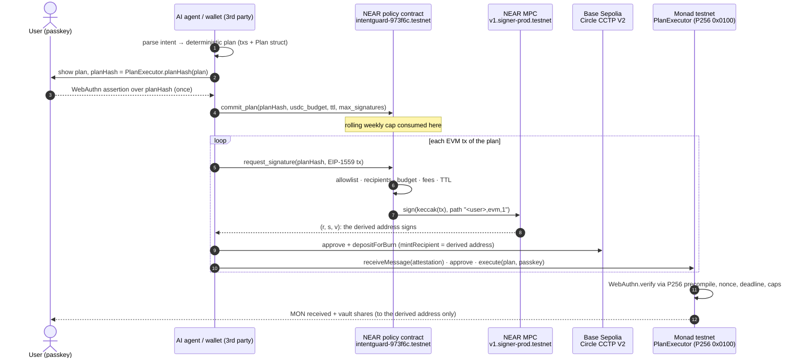

# IntentGuard: passkey-signed spending policies for AI agents

**A trust layer that any AI agent, wallet or dApp can build on.** The agent proposes; the user's passkey signs a policy and a plan. Two independent layers enforce it: NEAR (policy contract plus Chain Signatures MPC) and Monad (`PlanExecutor`, which verifies the passkey on-chain through the P256 precompile). Funds can move only within that policy.

> ⚠️ **Testnet only.** NEAR testnet, Monad testnet (chain 10143) and Base Sepolia. No real funds; the code is not audited. Built for **Monad Metropolis, Track 04: Trust, Identity & AI Infrastructure**.

| | |
|---|---|
| Monad contracts | `PlanExecutor` [`0x3f13…faC1`](https://testnet.monadexplorer.com/address/0x3f1391EC12002E10E18Efa82Af5E491f8159faC1), `MiniSwap` [`0x3D06…70f8`](https://testnet.monadexplorer.com/address/0x3D06B01a6B164322013547BEB4Fe0AfF985870f8), `DemoVault` [`0x66C2…8914`](https://testnet.monadexplorer.com/address/0x66C210D79d24a09FCa1F8Aae8c3a98A58F578914), all source-verified on Sourcify |
| NEAR policy contract | [`intentguard-973f6c.testnet`](https://testnet.nearblocks.io/address/intentguard-973f6c.testnet) → MPC `v1.signer-prod.testnet` |
| Real end-to-end run | Base Sepolia burn → Circle CCTP V2 → Monad mint → passkey-verified swap + vault deposit. Every tx is signed by MPC through the policy. [Links below](#monad-integration) |

---

## The problem

AI agents are starting to move money, but the trust model is still all or nothing:
- **Hot keys or custodial "agent wallets"**: the agent, or whoever compromises it, can drain everything.
- **Per-transaction pop-ups**: safe but unusable. The user approves opaque calldata they cannot read, one tx at a time, chain by chain.
- **Off-chain policy engines**: the rules live on a server that you have to trust.

What is missing is a **primitive**. The user approves *what* may happen once, with a passkey: the plan, the limits and the recipients. Then the chains, not the agent's server, refuse anything else.

## What IntentGuard provides

1. **One passkey, many keys.** A NEAR account plus a device passkey. With NEAR Chain Signatures, the policy contract derives one secp256k1 EVM address per user (path `"<user>,evm,1"`). The same address works on Monad and Base Sepolia. There is no seed phrase and no private key on the agent side.
2. **Policy before signature (NEAR).** The MPC network signs only what the policy contract forwards. The policy contract checks every EIP-1559 tx against:
   - an allowlist of chain, contract, selector and argument rules;
   - the user's own recipient addresses;
   - a rolling 7-day USDC cap;
   - a committed plan with a budget, a signature count and a TTL;
   - gas and fee ceilings.

   Loosening the policy (raising the cap, adding a recipient) requires a 1-yoctoNEAR deposit, which only the user's full-access key or wallet can attach. An agent holding a function-call key cannot do it.
3. **Passkey at execution (Monad).** `PlanExecutor` executes a plan only with a valid WebAuthn assertion over `planHash(plan)`. The hash is bound to the chain id and the contract. The check uses Solady `WebAuthn` → Monad's P256 precompile `0x0100`. It also enforces a nonce, a deadline, a per-plan ceiling and an on-chain weekly cap, and runs the swap and the vault deposit atomically.

The wallet PWA is the **reference integration**: chat → plan → passkey → execute. A static UI prototype is in [`app-demo/`](app-demo/intentguard.html), and [`scripts/`](scripts/) contains a headless reference client used for every real tx below. Any other agent framework or wallet integrates through the same contract calls.

## How it works



**Defense in depth:**
- If the agent is compromised, it can still request only allowlisted calls, to the user's own addresses, within the plan budget and the weekly cap.
- If the NEAR layer were bypassed, `PlanExecutor` still refuses to move funds without the passkey signature over that exact plan.

## Integration guide (for third-party agents and wallets)

An app needs no IntentGuard SDK. It makes five calls. The reference implementation is in [`scripts/lib/mpc.mjs`](scripts/lib/mpc.mjs) (`commitPlan`, `signAndSend`) and [`scripts/cctp-base-to-monad.mjs`](scripts/cctp-base-to-monad.mjs).

1. **Onboard (user's wallet or full-access key, once).**
   - `set_weekly_cap(weekly_cap)` and `add_recipient(<derived EVM address>)` on the policy contract, each with a 1 yocto deposit.
   - `PlanExecutor.registerPasskey(x, y, weeklyCap)` from the derived address, signed via the policy like any other tx.
   - Then give the agent a **function-call access key** restricted to the policy contract. It cannot attach deposits, so it can never loosen the policy.
2. **Build a plan.** Turn the user's intent into concrete EIP-1559 txs plus a `PlanExecutor.Plan`: `{account, amountIn, swapAmount, minAmountOut, unwrap, nonce, deadline}`. Compute `planHash = PlanExecutor.planHash(plan)`. Use the free view `check(user, plan_hash, tx)` to dry-run every tx and show the user readable rejections.
3. **Passkey approval.** `navigator.credentials.get({ challenge: planHash })`. Keep `authenticatorData`, `clientDataJSON`, `r` and `s` (low-S).
4. **Commit + sign.** `commit_plan(planHash, budget, ttl_seconds ≤ 3600, max_signatures ≤ 16)`, then `request_signature(planHash, tx)` for each tx. Attach 100 Tgas: about 13.5 Tgas are actually burned. The call returns `{big_r, s, recovery_id}`. Assemble the signed tx and broadcast it from the derived address.
5. **Execute on Monad.** `PlanExecutor.execute(plan, webauthnAuth)`. Outputs always go to `plan.account`. Anyone may relay it.

Allowlisted rule kinds today:
- `UsdcApprove{spender}`;
- `UsdcTransfer` (own recipients only);
- `CctpDepositForBurn{destination_domain, burn_token}`;
- `CctpReceiveMessage`;
- `PasskeyRegister`;
- `PlanExecute`;
- `NativeTransfer{max_value}`, meant to be temporary.

New protocols are added by the policy owner as `(chain, contract, selector) → rule`.

## Monad integration

- **P256 precompile `0x0100` (EIP-7951 on Monad)** verifies WebAuthn passkeys on-chain inside `PlanExecutor`. A live probe against Monad testnet confirms it: a valid assertion is accepted and a tampered one rejected (`scripts/live-checks/webauthn_live_probe.sh`).
- **Monad-aware engineering:** Foundry with `network = "monad"`. Monad charges the gas **limit**, so every tx uses estimate × 1.25 and the policy caps the gas limit and fees. One tx at a time per address.
- **Real cross-chain liquidity into Monad:** Circle CCTP V2 fast transfer from Base Sepolia (domain 6) to Monad (domain 15). The attestation comes from Circle's Iris sandbox API.

Deployed contracts (Monad testnet, chain 10143):

| Contract | Address | Deploy tx |
|---|---|---|
| PlanExecutor | [`0x3f1391EC12002E10E18Efa82Af5E491f8159faC1`](https://testnet.monadexplorer.com/address/0x3f1391EC12002E10E18Efa82Af5E491f8159faC1) | [0x56a46ee3…](https://testnet.monadexplorer.com/tx/0x56a46ee3abae5f16c03fca508e24f0190a6872b7b09417287c27ffd1870fb313) |
| MiniSwap (USDC/WMON, x·y=k) | [`0x3D06B01a6B164322013547BEB4Fe0AfF985870f8`](https://testnet.monadexplorer.com/address/0x3D06B01a6B164322013547BEB4Fe0AfF985870f8) | [0x2cd37e3e…](https://testnet.monadexplorer.com/tx/0x2cd37e3ef021fed2093227d25f4c4c92b8201d353173fb70fe5866f9b89555e7) |
| DemoVault (mock ERC-4626) | [`0x66C210D79d24a09FCa1F8Aae8c3a98A58F578914`](https://testnet.monadexplorer.com/address/0x66C210D79d24a09FCa1F8Aae8c3a98A58F578914) | [0x197892b7…](https://testnet.monadexplorer.com/tx/0x197892b79efaa76d6824745a633923aabd9eb60d76b71cef868d7c63235202fd) |

The user's derived address is `0xd2FE6a3Ae252D6fb2f604805898177c8FdaAa24B`, the same on Monad and Base Sepolia.

**Real full demo in one run** (`node scripts/cctp-base-to-monad.mjs --amount 2 --execute`, 135 s). One passkey-approved plan covers 5 signatures, each MPC-signed through the policy:

| Step | Tx |
|---|---|
| Base Sepolia: USDC approve → TokenMessengerV2 | [0x451d02b9…](https://sepolia.basescan.org/tx/0x451d02b978e82dd3c13bcfc87e351bb22380d1757977916e201621e5f6a4b23f) |
| Base Sepolia: `depositForBurn` 2 USDC, fast transfer | [0x8b1c6040…](https://sepolia.basescan.org/tx/0x8b1c6040af0300d49d5cc854ac5adc1c54e9877d6768c9aabd06fd7b48e68eda) |
| Monad: `receiveMessage`, 1.99974 USDC minted (attestation after 28 s) | [0x57986db9…](https://testnet.monadexplorer.com/tx/0x57986db9ce312e0d50b418d84d3add2fd4903911299e1a57adc9b9928679feaa) |
| Monad: USDC approve → PlanExecutor | [0xc2fa45e8…](https://testnet.monadexplorer.com/tx/0xc2fa45e863b0005074144d884daacaee61090e3d2c910feddb1556f7d5002e8b) |
| Monad: `PlanExecutor.execute`, passkey verified on-chain; half swapped to native MON, half into the vault | [0x4c0501ea…](https://testnet.monadexplorer.com/tx/0x4c0501ea37f917411543aab82536235a5a7fb6c2ecbba4339499a5919852585d) |

Other real runs:
- First MPC-signed broadcast on Monad: [0x9beb0227…](https://testnet.monadexplorer.com/tx/0x9beb0227b8d8578a47ca5853ee4831cc907c5714533bf47fcc76f1809b785d4a).
- First passkey-verified `execute`: [0x970c7022…](https://testnet.monadexplorer.com/tx/0x970c7022d4a7846cac0f515bf3a8dda2e2a209f5fb988d760f08e301aa47628f).
- Standalone CCTP leg in 67 s: [burn](https://sepolia.basescan.org/tx/0x5c9a64352d4b2ebed79d91f860c57b74db773860cae637d10b78156ee6fe22eb) → [mint](https://testnet.monadexplorer.com/tx/0x749fe4500c991156573080bd89ad4db06358489a1d7ee4fac6e023abf6e179a6).

Every hash is in [`deployments/`](deployments/).

**Negative cases, rejected on-chain:**
- A plan over the weekly cap is rejected by NEAR `commit_plan` («weekly cap exceeded»).
- «Send 50 USDC to 0xabc» is rejected by NEAR `request_signature` («recipient not in your allowlist»).
- A 6 USDC plan with a *valid* passkey signature reverts in `PlanExecutor` with `OverWeeklyCap`.

## Security model

| Threat | Mitigation |
|---|---|
| Compromised agent or leaked function-call key | It can only request signatures for allowlisted calls whose recipients are the user's own addresses, within the plan budget, the signature count, the TTL and the weekly cap. It cannot loosen the policy, because that needs a 1 yocto deposit from the full-access key. |
| Fee draining (Monad charges the gas limit) | Gas limit ≤ 2M and `maxFeePerGas` ≤ 1000 gwei are enforced before signing. Native value transfers are rejected unless an explicit `NativeTransfer` rule exists. |
| Unlimited approvals, foreign spenders | `approve` is allowed only on USDC, only to the allowlisted spender, and the amount must be ≤ the plan budget. |
| Replay, cross-chain or cross-deployment replay | `planHash` binds chain id and contract address. There is a per-account nonce, `executed[hash]` and a deadline. |
| Forged passkey approval | WebAuthn verification on-chain (P256 precompile) with user verification required. Low-S signatures are enforced by Solady. |
| MPC failure mid-plan | The callback returns the signature slot, so the plan can retry. |

Known limits:
- The passkey is verified on Monad, not on NEAR, so NEAR's guarantee is "bounded to the user's own addresses and caps".
- `CctpDepositForBurn` does not cap CCTP `maxFee` yet.
- The policy owner curates the allowlist.
- MiniSwap and DemoVault are demo contracts.
- The passkey used in the headless runs is a software test key. The PWA uses a real device passkey.

## Track 04 fit and bounties

- **Track 04, Trust, Identity & AI Infrastructure.** IntentGuard is a primitive: a passkey identity, user-signed spending policies and on-chain enforcement that other agents and wallets plug into. It is not a closed consumer app.
- **Mera: "One Passkey, Many Keys".** One device passkey plus one NEAR account control deterministic secp256k1 keys on every EVM chain via Chain Signatures, with no seed phrase.
- **Aurora Intents: any-chain liquidity to Monad.** Real CCTP V2 into Monad, gated by intent plans. A NEAR Intents 1Click route is the mainnet path; 1Click has no testnet.
- **MetaMask Agent Wallet Plugin.** The 5-call integration above is designed to be wrapped as an agent-wallet plugin: plan → passkey → policy-gated signing. The plugin itself is not built yet.

## Repo layout and setup

```
contracts/evm/          Foundry: PlanExecutor, MiniSwap, DemoVault, Deploy.s.sol, tests (forge-std, solady as submodules)
contracts/near-policy/  Rust near-sdk 5: policy contract + unit tests + local sandbox test
contracts/mock-mpc/     mock MPC signer (local sandbox only)
scripts/                reference client: lib/mpc.mjs, cctp-base-to-monad.mjs, live-checks/
deployments/            every deployed address and tx hash (NEAR, Monad, CCTP runs)
app-demo/               static UI prototype of the reference wallet PWA
docs/                   project plan (IT), CLAUDE.md, prompts
```

```bash
git clone --recurse-submodules https://github.com/francescantonio-stack/Intentguard && cd Intentguard
./run-all-checks.sh   # forge tests, Monad-fork test, cargo tests, NEAR sandbox, read-only live checks
```

Requirements: Foundry ≥ 1.8, Rust stable with the `wasm32-unknown-unknown` target, `cargo-near` 0.22, Node 20, Python 3 with `cryptography`.

Real testnet txs need `near-cli-rs` with a funded NEAR testnet account in the local keychain (`~/.near-credentials`). Keys are never stored in this repo.

Results on a fresh clone:

| Suite | Result |
|---|---|
| Foundry | 39 passed, 2 skipped |
| Monad testnet fork | 2 passed |
| NEAR unit | 26 passed |
| NEAR sandbox (policy → mock MPC → callback) | passed |
| Live P256 / WebAuthn probes on Monad and Base Sepolia | passed |

Detailed Italian working notes are in [README.it.md](README.it.md).

## AI tools disclosure

This project was built with AI coding assistants: **Claude Code** (Anthropic) and **Grok Bot**. They were used to write the code, tests, scripts and docs, and to run the testnet deployments and checks. The team (Dominiumchain) made the design decisions and approved every step. Every result reported here comes from executed code and real testnet txs.

## Pre-existing code

There is no pre-existing team code: everything in this repo was written for the hackathon, starting on 3 Oct 2026. The only third-party code is these open-source libraries, used under their licenses:

| Library | Use | License | How it is included |
|---|---|---|---|
| [forge-std](https://github.com/foundry-rs/forge-std) v1.17.0 | Solidity tests and scripts | MIT / Apache-2.0 | git submodule |
| [Solady](https://github.com/Vectorized/solady) v0.1.26 | WebAuthn/P256, SafeTransferLib, ReentrancyGuard, ERC4626, FixedPointMathLib | MIT | git submodule |
| [near-sdk-rs](https://github.com/near/near-sdk-rs) 5.x | NEAR contracts | MIT / Apache-2.0 | Cargo |
| near-workspaces, tokio, serde_json, hex | sandbox tests, encoding | see the crates | Cargo |
| [viem](https://github.com/wevm/viem), [chainsig.js](https://github.com/NearDeFi/chainsig.js) | reference client | MIT | npm |
| [cryptography](https://github.com/pyca/cryptography) | P-256 test vectors and test passkey | Apache-2.0 / BSD | pip |

External testnet contracts used but not included:
- the NEAR MPC signer;
- Circle USDC and CCTP V2;
- WMON;
- the PuddleSwap UniswapV2 router, used once by the deployer to obtain test USDC.

## License

[MIT](LICENSE) © 2026 Dominiumchain
