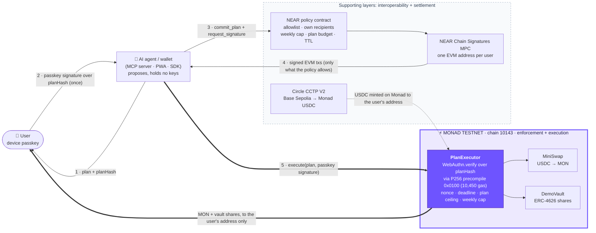
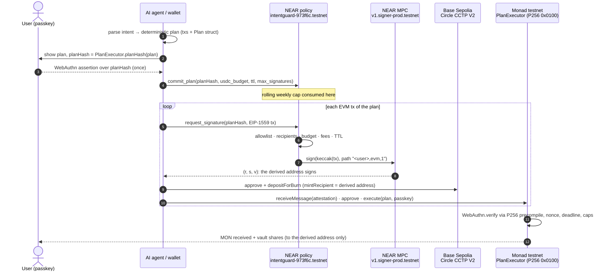

# IntentGuard: safe AI agents on Monad, approved with a passkey

**IntentGuard brings safe AI agents to Monad with on-chain P256 passkey verification.**
An AI agent proposes a plan. The user approves it once with a device passkey (WebAuthn). On Monad, `PlanExecutor` verifies that passkey signature on-chain through Monad's **P256 precompile (`0x0100`)** and moves funds only within the approved plan, its nonce, its deadline and the user's weekly cap. Nothing else gets executed.

> ⚠️ **Testnet only.** Monad testnet (chain 10143), plus NEAR testnet and Base Sepolia as supporting layers. No real funds; the code is not audited. Built for **Monad Metropolis, Track 04: Trust, Identity & AI Infrastructure**.

| On Monad testnet (chain 10143) | |
|---|---|
| **`PlanExecutor`** (passkey check + execution) | [`0x3f1391EC12002E10E18Efa82Af5E491f8159faC1`](https://testnet.monadexplorer.com/address/0x3f1391EC12002E10E18Efa82Af5E491f8159faC1) |
| `MiniSwap` (demo USDC/WMON pool) | [`0x3D06B01a6B164322013547BEB4Fe0AfF985870f8`](https://testnet.monadexplorer.com/address/0x3D06B01a6B164322013547BEB4Fe0AfF985870f8) |
| `DemoVault` (demo ERC-4626 vault) | [`0x66C210D79d24a09FCa1F8Aae8c3a98A58F578914`](https://testnet.monadexplorer.com/address/0x66C210D79d24a09FCa1F8Aae8c3a98A58F578914) |
| Source verification | all 3 contracts, Sourcify `exact_match` |
| Passkey check cost | **10,450 gas** per `WebAuthn.verify` with the P256 precompile ([`MonadGas.t.sol`](contracts/evm/test/MonadGas.t.sol)) |
| Passkey-verified execution | [`0x4c0501ea…`](https://testnet.monadexplorer.com/tx/0x4c0501ea37f917411543aab82536235a5a7fb6c2ecbba4339499a5919852585d): half swapped to native MON, half deposited into the vault |

**Contents:** [Why Monad](#why-monad) · [Architecture](#architecture) · [Deployed on Monad testnet](#deployed-on-monad-testnet) · [Run the tests locally](#run-the-tests-locally) · [Attacks blocked](#attacks-blocked-on-chain) · [Integration guide](#integration-guide-for-third-party-agents-and-wallets) · [Reference app](#reference-app-pwa) · [Deploy on Vercel](#deploy-on-vercel) · [Security model](#security-model) · [Roadmap](#roadmap)

---

## The problem

AI agents are starting to move money, but the trust model is still all or nothing:
- **Hot keys or custodial "agent wallets"**: the agent, or whoever compromises it, can drain everything.
- **A pop-up for every transaction**: safe but unusable. The user approves opaque calldata one tx at a time.
- **Off-chain policy engines**: the rules live on a server that you have to trust.

What is missing is a **primitive**. The user approves *what* may happen once, with a passkey: the plan, the limits and the recipients. Then the chain, not the agent's server, refuses everything else.

## Why Monad

Monad is where the user's approval is enforced. Monad is not one step among many: `PlanExecutor` is the last line of defense, and it holds even if the agent and every other layer are compromised.

- **Passkeys verified on-chain, every time.** WebAuthn passkeys sign with P-256 (secp256r1), not with Ethereum's secp256k1. Monad exposes a **P256 precompile at `0x0100` (EIP-7951)**. `PlanExecutor` uses Solady `WebAuthn` on top of it. A full `WebAuthn.verify` costs **10,450 gas**: [`MonadGas.t.sol`](contracts/evm/test/MonadGas.t.sol) measures it and asserts it stays under 50k. A pure-Solidity P-256 verifier costs hundreds of thousands of gas. With the precompile, IntentGuard checks the human's passkey on **every** plan, not once per session.
- **The passkey is the account's authority on Monad.** `registerPasskey` binds a passkey and a weekly cap to an account. Rotating the passkey (`rotatePasskey`) and changing the cap (`setWeeklyCap`) both require a valid signature from the current passkey. `execute` runs only with a valid assertion over `planHash(plan)`.
- **Replay-proof plans.** `planHash` is a domain-separated hash (`0x1901 ‖ chainid ‖ contract ‖ structHash`) bound to the chain id and to the `PlanExecutor` address. On top of that, Monad enforces a per-account nonce, `executed[hash]`, a deadline, a per-plan ceiling (`maxPlanAmount`, 100 USDC on the deployed contract) and a rolling 7-day cap. The swap and the vault deposit run atomically.
- **Built for Monad's execution model.** Foundry runs with `network = "monad"` (Monad gas semantics and precompiles, Foundry ≥ 1.8), so the tests exercise the real precompile. Monad charges the gas **limit**, not the gas used. So every tx sets its limit from an estimate plus a margin (×1.1 in `packages/signer`, ×1.25 in the reference scripts), and the policy rejects a gas limit above 2M or a fee above 1000 gwei. Each address sends one tx at a time.
- **Proven live, not only in tests.** A live probe ([`webauthn_live_probe.sh`](scripts/live-checks/webauthn_live_probe.sh)) against Monad testnet confirms the precompile accepts a valid assertion and rejects a tampered one. The deployed `PlanExecutor` has executed real passkey-approved plans ([links below](#deployed-on-monad-testnet)).

**Supporting layers, for interoperability and settlement:**
- **NEAR** adds a second, independent check *before* a signature exists. A policy contract plus Chain Signatures MPC give each user one EVM address on Monad, with no seed phrase and no private key on the agent side.
- **Circle CCTP V2** brings real (testnet) USDC from Base Sepolia into Monad.

Both serve the execution on Monad.

## Architecture



**Two independent layers of defense:**
- **Layer B, Monad (at execution).** `PlanExecutor` executes only with a valid passkey signature over that exact plan. If the NEAR layer were bypassed, Monad still refuses to move funds.
- **Layer A, NEAR (before signing).** The MPC network signs only what the policy contract forwards: allowlisted calls, to the user's own addresses, within the plan budget and the weekly cap. If the agent is compromised, this still holds.

<details>
<summary>Full sequence of one plan (step by step)</summary>



</details>

## Deployed on Monad testnet

Chain id **10143**. Deployed on 3 Oct 2026 with [`Deploy.s.sol`](contracts/evm/script/Deploy.s.sol). Every address and tx hash is also in [`deployments/monad-testnet.json`](deployments/monad-testnet.json).

| Contract | Address | Deploy tx |
|---|---|---|
| **PlanExecutor** | [`0x3f1391EC12002E10E18Efa82Af5E491f8159faC1`](https://testnet.monadexplorer.com/address/0x3f1391EC12002E10E18Efa82Af5E491f8159faC1) | [0x56a46ee3…](https://testnet.monadexplorer.com/tx/0x56a46ee3abae5f16c03fca508e24f0190a6872b7b09417287c27ffd1870fb313) |
| MiniSwap (USDC/WMON, x·y=k) | [`0x3D06B01a6B164322013547BEB4Fe0AfF985870f8`](https://testnet.monadexplorer.com/address/0x3D06B01a6B164322013547BEB4Fe0AfF985870f8) | [0x2cd37e3e…](https://testnet.monadexplorer.com/tx/0x2cd37e3ef021fed2093227d25f4c4c92b8201d353173fb70fe5866f9b89555e7) |
| DemoVault (mock ERC-4626) | [`0x66C210D79d24a09FCa1F8Aae8c3a98A58F578914`](https://testnet.monadexplorer.com/address/0x66C210D79d24a09FCa1F8Aae8c3a98A58F578914) | [0x197892b7…](https://testnet.monadexplorer.com/tx/0x197892b79efaa76d6824745a633923aabd9eb60d76b71cef868d7c63235202fd) |

The three contracts are source-verified on Sourcify (`exact_match`). External testnet contracts they use: Circle USDC [`0x534b2f3A21130d7a60830c2Df862319e593943A3`](https://testnet.monadexplorer.com/address/0x534b2f3A21130d7a60830c2Df862319e593943A3) and WMON [`0xFb8bf4c1CC7a94c73D209a149eA2AbEa852BC541`](https://testnet.monadexplorer.com/address/0xFb8bf4c1CC7a94c73D209a149eA2AbEa852BC541). The demo user's address on Monad is [`0xd2FE6a3Ae252D6fb2f604805898177c8FdaAa24B`](https://testnet.monadexplorer.com/address/0xd2FE6a3Ae252D6fb2f604805898177c8FdaAa24B), derived by NEAR Chain Signatures (the same address on Base Sepolia).

**Key transactions on Monad:**

| What | Tx | Gas used |
|---|---|---|
| `registerPasskey`: passkey + weekly cap bound to the account | [0xd0664407…](https://testnet.monadexplorer.com/tx/0xd0664407272683196866a2b455ca42cca374082853b10cbdd92d23b0ce8db3c8) | 145,942 |
| First passkey-verified `execute`: swap 0.2 USDC → MON + deposit 0.4 USDC | [0x970c7022…](https://testnet.monadexplorer.com/tx/0x970c7022d4a7846cac0f515bf3a8dda2e2a209f5fb988d760f08e301aa47628f) | 689,311 |
| Full-demo `execute`: 1.999479 USDC, half swapped to native MON, half into the vault | [0x4c0501ea…](https://testnet.monadexplorer.com/tx/0x4c0501ea37f917411543aab82536235a5a7fb6c2ecbba4339499a5919852585d) | 582,218 |
| CCTP `receiveMessage`: 1.99974 USDC minted on Monad | [0x57986db9…](https://testnet.monadexplorer.com/tx/0x57986db9ce312e0d50b418d84d3add2fd4903911299e1a57adc9b9928679feaa) | 408,796 |
| First MPC-signed broadcast on Monad (signed through the NEAR policy) | [0x9beb0227…](https://testnet.monadexplorer.com/tx/0x9beb0227b8d8578a47ca5853ee4831cc907c5714533bf47fcc76f1809b785d4a) | 21,000 |

### The full demo in one run

`node scripts/cctp-base-to-monad.mjs --amount 2 --execute` took **135 s** end to end. One passkey-approved plan covers 5 signatures. Each one is MPC-signed through the NEAR policy:

| # | Step | Tx |
|---|---|---|
| 1 | Base Sepolia: USDC approve → TokenMessengerV2 | [0x451d02b9…](https://sepolia.basescan.org/tx/0x451d02b978e82dd3c13bcfc87e351bb22380d1757977916e201621e5f6a4b23f) |
| 2 | Base Sepolia: `depositForBurn` 2 USDC, fast transfer | [0x8b1c6040…](https://sepolia.basescan.org/tx/0x8b1c6040af0300d49d5cc854ac5adc1c54e9877d6768c9aabd06fd7b48e68eda) |
| 3 | **Monad**: `receiveMessage`, 1.99974 USDC minted (Circle attestation after 28 s) | [0x57986db9…](https://testnet.monadexplorer.com/tx/0x57986db9ce312e0d50b418d84d3add2fd4903911299e1a57adc9b9928679feaa) |
| 4 | **Monad**: USDC approve → PlanExecutor | [0xc2fa45e8…](https://testnet.monadexplorer.com/tx/0xc2fa45e863b0005074144d884daacaee61090e3d2c910feddb1556f7d5002e8b) |
| 5 | **Monad**: `PlanExecutor.execute`, passkey verified on-chain; half swapped to native MON, half into the vault | [0x4c0501ea…](https://testnet.monadexplorer.com/tx/0x4c0501ea37f917411543aab82536235a5a7fb6c2ecbba4339499a5919852585d) |

Other runs: a standalone CCTP leg in 67 s ([burn](https://sepolia.basescan.org/tx/0x5c9a64352d4b2ebed79d91f860c57b74db773860cae637d10b78156ee6fe22eb) → [mint](https://testnet.monadexplorer.com/tx/0x749fe4500c991156573080bd89ad4db06358489a1d7ee4fac6e023abf6e179a6)). Every hash is in [`deployments/`](deployments/).

## Attacks blocked on-chain

Three out-of-policy attempts, three refusals:

| Attempt | Where it stops | Result |
|---|---|---|
| A 6 USDC plan **with a valid passkey signature**, above the weekly cap | **Monad, `PlanExecutor`** | reverts with `OverWeeklyCap(6000000, 4400000)`, simulated with `eth_call` against the deployed contract |
| A plan over the weekly cap | NEAR, `commit_plan` | «weekly cap exceeded» |
| «Send 50 USDC to 0xabc» | NEAR, `request_signature` | «recipient not in your allowlist» |

The first case is the important one: even a genuine passkey signature cannot push spending past the limits enforced on Monad. The PWA's attack demo replays these refusals live (see [Reference app](#reference-app-pwa)).

## Run the tests locally

**Requirements:**
- **Foundry ≥ 1.8** (tested with v1.8.1): `foundryup --install v1.8.1`. `foundry.toml` sets `network = "monad"`, which needs it. Plain `foundryup` installs the older "stable" release (1.5.x), which ignores `network = "monad"`: the P256 precompile is then missing and the passkey tests fail.
- Node 22 with pnpm (the PWA on Vercel is pinned to 22.x).
- Rust stable with the `wasm32-unknown-unknown` target, and `cargo-near` 0.22 (only for the NEAR sandbox).
- Python 3 with `cryptography` (only for the live checks).

```bash
git clone --recurse-submodules https://github.com/francescantonio-stack/Intentguard-MAXMODv1
cd Intentguard-MAXMODv1
```

**1. Foundry (Solidity, Monad):**
```bash
cd contracts/evm
forge test                                       # unit, fuzz, invariants, WebAuthn vectors
forge test --match-contract MonadGas -vv         # prints the WebAuthn.verify gas with the P256 precompile
FORK=1 forge test --match-contract MonadFork -vv # local fork of Monad testnet (real USDC/WMON, nothing broadcast)
```

**2. TypeScript (core, signer, MCP):**
```bash
pnpm install
pnpm -r test                                         # all packages
LIVE=1 pnpm --filter @intentguard/core test          # also checks planHash against the deployed PlanExecutor
pnpm --filter @intentguard/web dev                   # the PWA on http://localhost:3000
```

**3. NEAR policy (Rust):**
```bash
cd contracts/near-policy && cargo test --lib
```

**Everything at once:** `./run-all-checks.sh` runs the Foundry tests, the Monad fork test, the NEAR unit and sandbox tests, and the read-only live checks. It needs no keys, no funds, and sends no transactions.

**Results on a fresh clone** (re-run on 10 Oct 2026; rows marked † need network access to Monad/NEAR and are from the last run on 3 Oct 2026):

| Suite | Result |
|---|---|
| Foundry: unit, fuzz, 5 invariants over 8,192 random calls, WebAuthn vectors (incl. a real phone passkey and one produced by Chromium through the app's code) | **44 passed**, 1 skipped |
| `WebAuthn.verify` gas with the Monad P256 precompile | **10,450** |
| Monad testnet fork (`FORK=1`) † | 2 passed |
| TypeScript: core, signer, MCP | **58 passed**, 1 skipped |
| NEAR policy unit tests | **27 passed** |
| NEAR sandbox (policy → mock MPC → callback) † | passed |
| Live P256 / WebAuthn probes on Monad and Base Sepolia † | passed |

What is skipped by default, and why:
- **Foundry, 1 skipped.** The Monad fork suite runs only with `FORK=1`.
- The real-device WebAuthn vector (`test/fixtures/browser_vector.json`) comes from a phone passkey with user verification, generated with [`make-vector.html`](contracts/evm/tools/make-vector.html). The same Solady `WebAuthn.verify` used by `PlanExecutor` accepts it and rejects it for any other challenge.
- **TypeScript, 1 skipped.** The live `planHash` check runs only with `LIVE=1`, because it reads from Monad testnet.

## What IntentGuard provides

1. **Passkey execution on Monad.** `PlanExecutor` executes a plan only with a valid WebAuthn assertion over `planHash(plan)`. It checks the assertion with Solady `WebAuthn` → P256 precompile `0x0100`, enforces nonce, deadline, per-plan ceiling and weekly cap, and runs the swap and the vault deposit atomically. Outputs always go to `plan.account`.
2. **One passkey, one address, no seed phrase.** A NEAR account plus a device passkey. With NEAR Chain Signatures, the policy contract derives one secp256k1 EVM address per user (path `"<user>,evm,1"`). That address acts on Monad, and the same address works on Base Sepolia. There is no private key on the agent side.
3. **Policy before signature (NEAR).** The MPC network signs only what the policy contract forwards. The policy checks every EIP-1559 tx against:
   - an allowlist of chain, contract, selector and argument rules;
   - the user's own recipient addresses;
   - a rolling 7-day USDC cap;
   - a committed plan with a budget, a signature count and a TTL;
   - gas and fee ceilings.

   Loosening the policy (raising the cap, adding a recipient) requires a 1 yoctoNEAR deposit, which only the user's full-access key or wallet can attach. An agent holding a function-call key cannot do it.

The wallet PWA is the **reference integration**: chat → plan → passkey → execution on Monad. A static UI prototype is in [`app-demo/`](app-demo/intentguard.html), and [`scripts/`](scripts/) contains the headless reference client used for every real tx above. Any other agent framework or wallet integrates through the same contract calls.

## Integration guide (for third-party agents and wallets)

An app needs no IntentGuard SDK. It makes five calls. The TypeScript reference implementation is [`packages/signer`](packages/signer) (`PolicyClient`, `signAndSend`, `runPlan`) on top of [`packages/core`](packages/core) (intent schema, deterministic planner, `planHash`, WebAuthn struct). The original Node scripts are in [`scripts/`](scripts).

1. **Onboard (once, from the user's wallet or full-access key).**
   - `set_weekly_cap(weekly_cap)` and `add_recipient(<derived EVM address>)` on the NEAR policy contract, each with a 1 yocto deposit.
   - `PlanExecutor.registerPasskey(x, y, weeklyCap)` on Monad, from the derived address, signed through the policy like any other tx.
   - Then give the agent a **function-call access key** restricted to the policy contract. It cannot attach deposits, so it can never loosen the policy.
2. **Build a plan.** Turn the user's intent into concrete EIP-1559 txs plus a `PlanExecutor.Plan`: `{account, amountIn, swapAmount, minAmountOut, unwrap, nonce, deadline}`. Compute `planHash = PlanExecutor.planHash(plan)`. Use the free view `check(user, plan_hash, tx)` on NEAR to dry-run every tx and show the user readable rejections.
3. **Passkey approval.** `navigator.credentials.get({ challenge: planHash })`. Keep `authenticatorData`, `clientDataJSON`, `r` and `s` (low-S).
4. **Commit + sign.** `commit_plan(planHash, budget, ttl_seconds ≤ 3600, max_signatures ≤ 16)`, then `request_signature(planHash, tx)` for each tx. Attach 100 Tgas; about 13.5 Tgas are actually burned. The call returns `{big_r, s, recovery_id}`. Assemble the signed tx and broadcast it from the derived address.
5. **Execute on Monad.** `PlanExecutor.execute(plan, webauthnAuth)`. Outputs always go to `plan.account`, so anyone may relay it.

Rule kinds on the allowlist today:
- `UsdcApprove{spender}`;
- `UsdcTransfer` (own recipients only);
- `CctpDepositForBurn{destination_domain, burn_token}`;
- `CctpReceiveMessage`;
- `PasskeyRegister`;
- `PlanExecute`;
- `NativeTransfer{max_value}`, meant to be temporary.

The policy owner adds new protocols as `(chain, contract, selector) → rule`.

### Plug in any AI agent (MCP)

[`packages/mcp`](packages/mcp) is a Model Context Protocol server. An agent gets **read + propose** access and **no keys**:

| Tool | What it does |
|---|---|
| `intentguard_status` | derived address, allowance left on NEAR and Monad, passkey registration, balances |
| `intentguard_propose_plan` | natural language or structured intent → checked plan + approval link; out-of-policy plans come back `BLOCKED` with the reason |
| `intentguard_recent_decisions` | the policy contract's latest allowed and rejected requests |

```bash
claude mcp add intentguard -e NEAR_USER=<you>.testnet -e APP_URL=https://<your-app> -- npx tsx <repo>/packages/mcp/src/server.ts
```

The user opens the link, sees the same plan rebuilt from on-chain state, and approves it with the passkey. A prompt-injected agent can propose anything; nothing outside the policy gets signed, and nothing without the passkey gets executed on Monad.

## Reference app (PWA)

[`apps/web`](apps/web) is an installable Next.js app:
- **setup:** NEAR account, on-device function-call key, passkey, registration on Monad;
- **guard:** command → plan → one passkey approval → policy-gated execution on Monad, with explorer links;
- **guard log:** a live view of the policy contract's decisions;
- **attack demo:** a hijacked agent is stopped three times, by the planner, by the NEAR policy on-chain, and by `PlanExecutor`'s passkey check on Monad.

LLM keys stay server-side, and the deterministic parser keeps the app working without them.

### Deploy on Vercel

Import the **repository root**, then set the project as below. `*.vercel.app` is HTTPS, which is required for real passkeys. The user connects the Vercel account; this repo is already wired for that import.

| Setting | Value |
|---|---|
| Framework | Next.js |
| Root Directory | `apps/web` |
| Install Command | `pnpm install --frozen-lockfile --filter @intentguard/web...` |
| Build Command | `pnpm build` |
| Node.js Version | **22.x** |
| Output | leave the Next.js default |

[`apps/web/vercel.json`](apps/web/vercel.json) already pins the install and build commands. Workspace packages (`@intentguard/core`, `@intentguard/signer`) are TypeScript source: Next.js transpiles them (`transpilePackages`) and traces them from the monorepo root (`outputFileTracingRoot`). The PWA never reads `~/.near-credentials` or other local files; the device function-call key lives in the browser.

**Environment variables** (Project → Settings → Environment Variables, Production + Preview). None are required. With no LLM key the rules parser still handles the demo command. Full list: [`.env.example`](.env.example).

| Variable | Where | Required | Default |
|---|---|---|---|
| `NEXT_PUBLIC_POLICY_CONTRACT_ID` | Public | no | `intentguard-973f6c.testnet` |
| `NEXT_PUBLIC_RP_ID` | Public | no | current hostname (`window.location.hostname`) |
| `NEXT_PUBLIC_APP_URL` | Public | no | `https://$VERCEL_URL` |
| `LLM_PROVIDER` | Server | no | `rules` (or `gemini` / `groq` if a key is set) |
| `GEMINI_API_KEY` | Server | no | unset → rules parser |
| `GEMINI_MODEL` | Server | no | `gemini-3.5-flash-lite` |
| `GROQ_API_KEY` | Server | no | unset |
| `GROQ_MODEL` | Server | no | `openai/gpt-oss-20b` |
| `MONAD_RPC_URL` | Server | no | `https://testnet-rpc.monad.xyz` (chain 10143) |
| `BASE_SEPOLIA_RPC_URL` | Server | no | `https://sepolia.base.org` (chain 84532) |
| `NEAR_RPC_URL` | Server | no | `https://rpc.testnet.near.org` |
| `CIRCLE_IRIS_API_URL` | Server | no | `https://iris-api-sandbox.circle.com` |

Do **not** set `NEAR_PRIVATE_KEY`, `DEPLOYER_PRIVATE_KEY`, or any secret as `NEXT_PUBLIC_*`. LLM keys stay server-side.

**After deploy (manual):** open the Vercel URL on the phone, create the passkey **on that origin** (a localhost passkey will not work on `*.vercel.app`), and run the three `near` CLI commands shown on Setup. Optional: set `GEMINI_API_KEY` for nicer parsing. Preview URLs (`*-git-*.vercel.app`) have a different host than production, so passkeys do not carry across.

## Security model

| Threat | Mitigation |
|---|---|
| Forged passkey approval | WebAuthn verified on-chain on Monad (P256 precompile) with user verification required. Solady enforces low-S signatures. |
| Replay, cross-chain or cross-deployment replay | `planHash` binds chain id and contract address. There is a per-account nonce, `executed[hash]` and a deadline. |
| Hijacked or prompt-injected agent | The agent only proposes. The off-chain planner, the NEAR policy and `PlanExecutor` each refuse plans outside the policy. Invariant tests fuzz replays, foreign passkeys, edited plans and time jumps ([`PlanExecutorInvariant.t.sol`](contracts/evm/test/PlanExecutorInvariant.t.sol)). |
| Compromised agent or leaked function-call key | It can only request signatures for allowlisted calls to the user's own addresses, within the plan budget, the signature count, the TTL and the weekly cap. It cannot loosen the policy, because that needs a 1 yocto deposit from the full-access key. |
| Fee draining (Monad charges the gas limit) | Gas limit ≤ 2M and `maxFeePerGas` ≤ 1000 gwei are enforced before signing. Native value transfers are rejected unless an explicit `NativeTransfer` rule exists. |
| Unlimited approvals, foreign spenders | `approve` is allowed only on USDC, only to the allowlisted spender, and the amount must be ≤ the plan budget. |
| MPC failure mid-plan | The callback returns the signature slot, so the plan can retry. |

Known limits:
- The passkey is verified on Monad, not on NEAR. NEAR's guarantee is therefore "bounded to the user's own addresses and caps".
- `CctpDepositForBurn` caps the CCTP `maxFee` at 0.5% of the amount in this repo; the deployed testnet policy needs the upgrade described in `docs/CHIAVI.md` §5.
- The policy owner curates the allowlist.
- MiniSwap and DemoVault are demo contracts.
- The passkey in the headless testnet runs is a software test key. The PWA uses a real device passkey, and a real phone passkey assertion is verified in the Foundry tests.

## Track 04 fit and bounties

- **Track 04: Trust, Identity & AI Infrastructure.** IntentGuard is a primitive for Monad: a passkey identity verified on Monad, user-signed spending policies, and on-chain enforcement that other agents and wallets plug into. It is not a closed consumer app.
- **Mera, "One Passkey, Many Keys".** One device passkey plus one NEAR account control deterministic secp256k1 keys on every EVM chain via Chain Signatures, with no seed phrase.
- **Aurora Intents, any-chain liquidity to Monad.** Real CCTP V2 into Monad, gated by intent plans. A NEAR Intents 1Click route is the mainnet path; 1Click has no testnet.
- **MetaMask Agent Wallet Plugin.** The 5-call integration and the MCP server give agents a plan → passkey → policy-gated signing flow. A MetaMask Snap wrapper is not built yet.

**Also planned (not built):** passkey verification on NEAR as well, a code audit, mainnet on Monad and Base with NEAR Intents 1Click, and a MetaMask Snap wrapper. See [Roadmap](#roadmap).

## Roadmap

**Planned, not built.** Monad stays the enforcement center: a `PlanExecutor` on each new chain still verifies the same device passkey through a cheap P256 precompile. The live demo remains **USDC ↔ MON on Monad testnet**. Extra MiniSwap demo tokens are not on this list: `PlanExecutor` hardcodes USDC/WMON, and the deployed NEAR policy allowlists only those USDC / `execute` / `registerPasskey` targets. Changing that would need a new executor address, new pools, and owner `add_rule` calls — it would replace the live demo, not extend it.

### Multichain execution

Same derived EVM address on every EVM chain via NEAR Chain Signatures path `"<user>,evm,1"`. Each chain gets its own `PlanExecutor`. Supporting layers stay the same: NEAR policy + Chain Signatures, Circle CCTP V2 where USDC exists, testnet first.

**First wave** (cheap P256 precompile + Circle CCTP V2 + a public testnet): **Base, Arbitrum, Unichain**.

**Then:** Ethereum, OP, Linea, World Chain, Ink, Avalanche, Polygon PoS, BNB Chain (no CCTP USDC), Sei (P256 at `0x1011`).

**After the EVM set:** Solana — Ed25519 Chain Signatures and a new executor (not the current `PlanExecutor`).

**NEAR policy upgrade required** before any of this can go live. Today chain ids are hardcoded to Monad testnet (`10143`) and Base Sepolia (`84532`), USDC addresses are set only in `new()`, and rules are single-spender / single-domain. That upgrade needs a `set_usdc` setter and multi-spender / multi-domain rule variants. It is a policy redeploy or owner migration, not a UI change.

### Any-token swaps on mainnet

A DEX aggregator (not more in-house MiniSwap pools) so a plan can sell tokens other than USDC, with:

- **token safety checks** before a route is proposed: honeypot / sell-tax, contract verification, liquidity thresholds;
- **a price oracle** so per-plan and weekly caps are denominated in **USD**, not USDC only;
- **allowlisted routers** in the NEAR policy (same allowlist model as today: chain, contract, selector, argument rules).

The live testnet path stays Circle USDC → MiniSwap USDC/WMON → DemoVault. Do not read this section as support for extra tokens in the current PWA.

## Repo layout

```
contracts/evm/          Foundry (network = "monad"): PlanExecutor, MiniSwap, DemoVault, Deploy.s.sol, tests (forge-std, solady as submodules)
contracts/near-policy/  Rust near-sdk 5: policy contract + unit tests + local sandbox test
contracts/mock-mpc/     mock MPC signer (local sandbox only)
packages/core/          intent schema (zod), rules parser, deterministic planner, planHash, WebAuthn struct (bigint only)
packages/signer/        NEAR policy client, Chain Signatures derivation, MPC signing pipeline, CCTP helpers, plan runner
packages/mcp/           MCP server for AI agents (read + propose, no keys)
apps/web/               reference PWA (Next.js): setup, plan + passkey approval, execution timeline, guard log, attack demo
scripts/                reference client: lib/mpc.mjs, cctp-base-to-monad.mjs, live-checks/
deployments/            every deployed address and tx hash (Monad, NEAR, CCTP runs)
app-demo/               static UI prototype of the reference wallet PWA
docs/                   project plan (IT), CLAUDE.md, prompts, submission write-up
```

Real testnet txs need `near-cli-rs` with a funded NEAR testnet account in the local keychain (`~/.near-credentials`). Keys are never stored in this repo.

Detailed Italian working notes are in [README.it.md](README.it.md).

## AI tools disclosure

This project was built with AI coding assistants: **Claude Code** (Anthropic) and **Grok Bot**. They were used to write the code, tests, scripts and docs, and to run the testnet deployments and checks. The team (Dominiumchain) made the design decisions and approved every step. Every result reported here comes from executed code and real testnet txs.

## Pre-existing code

There is no pre-existing team code: everything in this repo was written for the hackathon, starting on 3 Oct 2026. The only third-party code is these open-source libraries, used under their licenses:

| Library | Use | License | How it is included |
|---|---|---|---|
| [forge-std](https://github.com/foundry-rs/forge-std) v1.17.0 | Solidity tests and scripts | MIT / Apache-2.0 | git submodule |
| [Solady](https://github.com/Vectorized/solady) v0.1.26 | WebAuthn/P256, SafeTransferLib, ReentrancyGuard, ERC4626, FixedPointMathLib | MIT | git submodule |
| [near-sdk-rs](https://github.com/near/near-sdk-rs) 5.x | NEAR contracts | MIT / Apache-2.0 | Cargo |
| near-workspaces, tokio, serde_json, hex | sandbox tests, encoding | see the crates | Cargo |
| [viem](https://github.com/wevm/viem), [chainsig.js](https://github.com/NearDeFi/chainsig.js) | reference client | MIT | npm |
| [cryptography](https://github.com/pyca/cryptography) | P-256 test vectors and test passkey | Apache-2.0 / BSD | pip |

External testnet contracts used but not included:
- the NEAR MPC signer;
- Circle USDC and CCTP V2;
- WMON;
- the PuddleSwap UniswapV2 router, used once by the deployer to obtain test USDC.

## License

[MIT](LICENSE) © 2026 Dominiumchain
